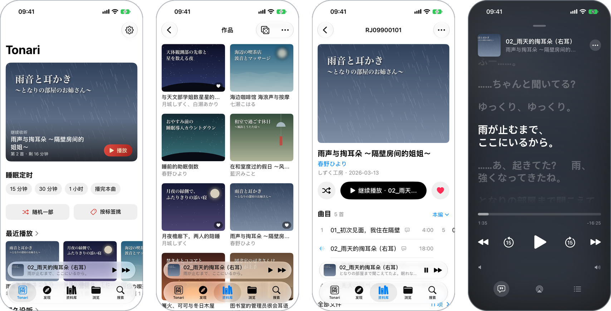

<p align="center">
  
</p>

<h1 align="center">Tonari</h1>

<p align="center">
  An ASMR / doujin voice player for iOS that organizes your collection by DLsite work (RJ code).
</p>

<p align="center">
  <a href="https://github.com/leorxx11/Tonari/actions/workflows/ci.yml"></a>
  
  
  <a href="LICENSE"></a>
</p>

<p align="center">
  <a href="README.md">简体中文</a> · English
</p>

<p align="center">
  
</p>

<p align="center"><sub>Home · Works · Work page · Player with subtitles. The works, covers and voice actors shown are fictional demo data.</sub></p>

The app's interface is in Chinese.

## Features

- **Organized by work**: import folders whose names contain an RJ code; Tonari finds each work and pulls the cover, voice actors, circle, tags and description from DLsite.
- **Local and cloud**: local folders, 115 cloud drive (QR-code login) and WebDAV servers. Remote works stream directly, and 115 works can be downloaded for offline listening.
- **Playback modeled on Apple Music**: background audio, lock-screen controls and AirPlay; a sleep timer by time or by track count that fades out at the end; playback speed, four play modes, and per-work resume.
- **Subtitles**: srt / lrc / vtt / ass files are matched automatically and scroll like lyrics; Picture-in-Picture subtitles keep the current line visible over other apps.
- **Video**: decoded by mdk-sdk, so MKV, HEVC and 10-bit files play.
- **DLsite online**: browse rankings, new releases and sales, open live work pages with chobit previews, and sync your account wishlist after signing in on DLsite's own page.
- **Translation**: plug in any OpenAI-compatible service to translate titles, descriptions and track names into Chinese.
- **More**: favorite groups, listening stats, Shortcuts and Siri, background blur, full backup and restore.

The full spec (in Chinese) is in [docs/REQUIREMENTS.md](docs/REQUIREMENTS.md).

## Install

Tonari is not on the App Store and no signed builds are provided. Build it yourself:

- Run it from Xcode on your own iPhone. A free Apple ID works; the signature lasts 7 days, after which you reinstall.
- Or build for Release and re-sign the product with your own certificate into an ipa to sideload.

## Build

Development and CI use Xcode 27. Swift package dependencies (GRDB, SwiftSoup, mdk-sdk) download the first time the project opens.

```bash
git clone https://github.com/leorxx11/Tonari.git
open Tonari/native/Tonari.xcodeproj
```

In Xcode, select the Tonari target → Signing & Capabilities, switch Team to your own, change the Bundle Identifier to one of yours (for example `com.example.tonari`), then run on your device.

Tests and an unsigned Release build from the command line:

```bash
cd native/TonariCore && swift test
```

```bash
cd native && xcodebuild -project Tonari.xcodeproj -scheme Tonari -configuration Release -destination 'generic/platform=iOS' -derivedDataPath build/DerivedData CODE_SIGNING_ALLOWED=NO build
```

## Usage

Which folder to import, how subtitles are matched, and what to know about backups and re-signing: see the [usage guide](docs/USAGE.en.md).

## Project layout

| Path | Contents |
|---|---|
| `native/Tonari/` | The app (SwiftUI) |
| `native/TonariCore/` | Logic-only Swift package: database, import, DLsite, 115, WebDAV, subtitles, translation, backup; `swift test` runs on macOS |
| `native/Packages/MDK/` | mdk-sdk binary and its Swift wrapper |
| `docs/` | [Usage guide](docs/USAGE.en.md); [spec](docs/REQUIREMENTS.md), [plan and implementation notes](docs/PLAN.md), [UI mockups](docs/design/) (in Chinese) |
| `AGENTS.md` | Working agreement for AI coding agents |

The original Flutter version is archived on the [`flutter`](https://github.com/leorxx11/Tonari/tree/flutter) branch and no longer maintained.

## Third-party components

| Component | Used for | License |
|---|---|---|
| [GRDB.swift](https://github.com/groue/GRDB.swift) | SQLite database | MIT |
| [SwiftSoup](https://github.com/scinfu/SwiftSoup) | HTML parsing | MIT |
| [mdk-sdk](https://github.com/wang-bin/mdk-sdk) | Video playback | Proprietary; open-source projects can request a free key from the author, see its README |

## Disclaimer

Tonari is an unofficial third-party client with no affiliation with DLsite, 115 or their operators. The app neither provides nor hosts any content; buy works on DLsite.

## License

[MIT](LICENSE)
