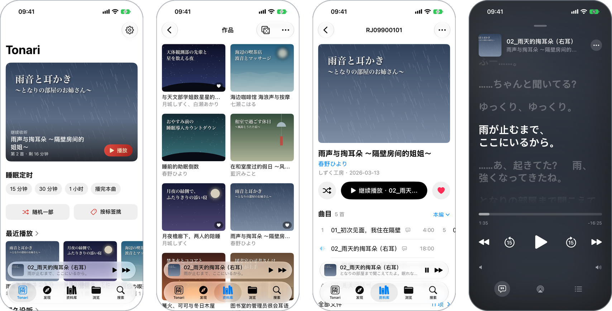

<p align="center">
  
</p>

<h1 align="center">Tonari</h1>

<p align="center">
  iOS 上的 ASMR / 同人音声播放器，按 DLsite 作品（RJ 编号）整理你的收藏。
</p>

<p align="center">
  <a href="https://github.com/leorxx11/Tonari/actions/workflows/ci.yml"></a>
  <a href="https://github.com/leorxx11/Tonari/releases/latest"></a>
  
  
  <a href="LICENSE"></a>
</p>

<p align="center">
  简体中文 · <a href="README.en.md">English</a>
</p>

<p align="center">
  
</p>

<p align="center"><sub>主页 · 作品墙 · 作品详情 · 字幕播放。截图中的作品、封面与声优均为虚构的演示数据。</sub></p>

## 功能

- **以作品为单位**：导入含 RJ 编号的文件夹，自动识别作品，从 DLsite 抓取封面、声优、社团、标签和简介。
- **本地与云端**：本地文件夹、115 网盘（扫码登录）、WebDAV 服务器；远程作品直连流播，115 作品还能下载到本机离线听。
- **播放体验对标 Apple Music**：后台播放、锁屏控制、AirPlay；睡眠定时可按时间或曲数，结束前淡出；倍速、四种播放模式，按作品记住进度。
- **字幕**：自动关联 srt / lrc / vtt / ass，像歌词一样滚动；画中画字幕让你在别的 App 里也能看到当前句。
- **视频**：mdk-sdk 解码，MKV、HEVC、10-bit 都能放。
- **DLsite 在线**：看排行、新作、特价，打开在线作品页听 chobit 试听；网页登录后同步账号愿望单。
- **翻译**：接入任意 OpenAI 兼容服务，把标题、简介、曲目名翻成中文。
- **其他**：收藏分组、收听统计、快捷指令与 Siri、后台模糊、完整备份与恢复。

需求与设计的完整说明见 [docs/REQUIREMENTS.md](docs/REQUIREMENTS.md)。

## 安装

Tonari 不上架 App Store，需要 iOS 26.1 或更高，两种装法：

- 从 [Releases](https://github.com/leorxx11/Tonari/releases/latest) 下载未签名的 ipa，用侧载工具（例如 Sideloadly、AltStore / SideStore）或自己的证书签名后安装。
- 按下面「构建」用 Xcode 直接装到自己的 iPhone。

免费 Apple ID 的签名 7 天有效，过期后用同一个 Apple ID 重新签名覆盖安装，数据会保留；换证书或 Bundle ID 则相当于换了一个 App，见[使用说明](docs/USAGE.md#备份与换签名)。

## 构建

开发与 CI 使用 Xcode 27。Swift 包依赖（GRDB、SwiftSoup、mdk-sdk）首次打开工程时自动下载。

```bash
git clone https://github.com/leorxx11/Tonari.git
open Tonari/native/Tonari.xcodeproj
```

在 Xcode 里选中 Tonari target →「Signing & Capabilities」，把 Team 换成你自己的，Bundle Identifier 改成你自己的（例如 `com.example.tonari`），然后选你的设备运行。

命令行跑测试与不签名的 Release 构建：

```bash
cd native/TonariCore && swift test
```

```bash
cd native && xcodebuild -project Tonari.xcodeproj -scheme Tonari -configuration Release -destination 'generic/platform=iOS' -derivedDataPath build/DerivedData CODE_SIGNING_ALLOWED=NO build
```

## 使用

导入哪个文件夹、字幕怎么关联、备份与换签名的注意事项，见[使用说明](docs/USAGE.md)。

## 项目结构

| 路径 | 内容 |
|---|---|
| `native/Tonari/` | App（SwiftUI） |
| `native/TonariCore/` | 纯逻辑 Swift 包：数据库、导入、DLsite、115、WebDAV、字幕、翻译、备份，可在 macOS 上 `swift test` |
| `native/Packages/MDK/` | mdk-sdk 二进制与 Swift 封装 |
| `docs/` | [使用说明](docs/USAGE.md)、[需求与设计](docs/REQUIREMENTS.md)、[排期与实现要点](docs/PLAN.md)、[界面示意](docs/design/) |
| `AGENTS.md` | 给 AI 编码助手的协作约定 |

最早的 Flutter 版归档在 [`flutter`](https://github.com/leorxx11/Tonari/tree/flutter) 分支，不再维护。

## 第三方组件

| 组件 | 用途 | 许可 |
|---|---|---|
| [GRDB.swift](https://github.com/groue/GRDB.swift) | SQLite 数据库 | MIT |
| [SwiftSoup](https://github.com/scinfu/SwiftSoup) | HTML 解析 | MIT |
| [mdk-sdk](https://github.com/wang-bin/mdk-sdk) | 视频播放 | 专有许可，开源项目可向作者免费申请 key，详见其 README |

## 声明

Tonari 是非官方的第三方客户端，与 DLsite、115 网盘及其运营方没有任何关联。App 不提供、不托管任何作品内容，作品请在 DLsite 购买。

## 友情链接

- [LINUX DO](https://linux.do/)：新的理想型社区

## 许可

[MIT](LICENSE)
